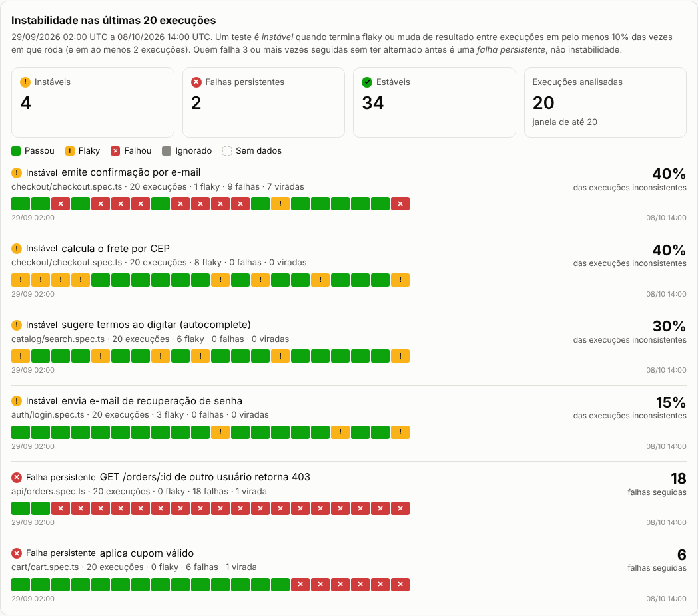
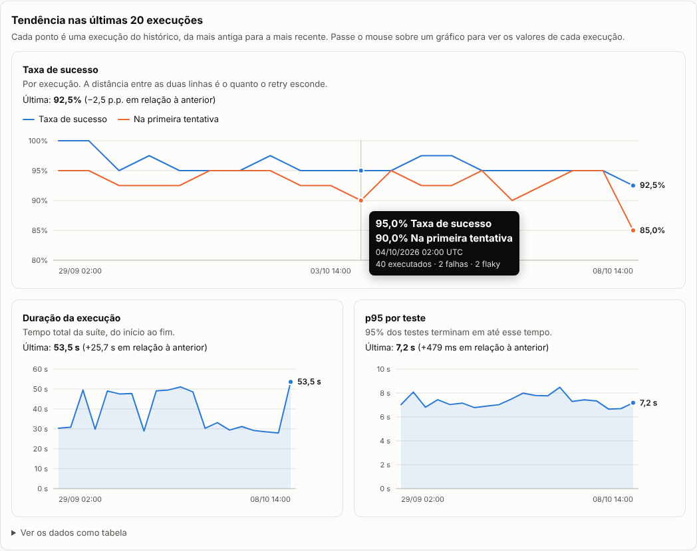

# QA Insights

Transforma o relatório JSON do Playwright em um dashboard de qualidade: taxa de sucesso, testes mais lentos, resultado por suíte, falhas e, a partir do histórico de execuções, **quais testes são instáveis (*flaky*) e quais estão quebrados de verdade**. Tudo em uma única página HTML.






> **Dados de demonstração.** O relatório e o histórico de 30 execuções em `data/sample/` são **sintéticos**: foram gerados por [`scripts/make-sample.mjs`](scripts/make-sample.mjs) e [`scripts/make-sample-history.mjs`](scripts/make-sample-history.mjs) para uma loja virtual fictícia, com semente fixa (mesma saída a cada execução). Cada teste do histórico recebe um comportamento definido de propósito (instável, regressão, bug persistente, estável) para a análise ter o que encontrar. Nenhum número aqui vem de um sistema real.

## Por que isso existe

O relatório padrão do Playwright mostra **uma execução**. Quem mantém uma suíte automatizada precisa responder perguntas que um relatório isolado não responde: quais testes estão instáveis, qual falha é regressão e qual é ruído, onde está o tempo do CI. Este projeto responde a primeira com o histórico entre execuções e as demais com a execução mais recente.

## Status

- **Fase 1:** análise de uma execução e dashboard. Concluída.
- **Fase 2:** histórico de execuções e taxa de instabilidade por teste. Concluída.
- **Fase 3:** gráficos de tendência e registro automático do histórico no CI. Concluída; o deploy público depende de você ativar o GitHub Pages (abaixo).

## Uso

Requer Node.js 20 ou superior. Não há dependências para instalar.

**Uma execução (Fase 1):**

```bash
# 1. Gere o relatório JSON no seu projeto com Playwright
npx playwright test --reporter=json > report.json

# 2. Gere o dashboard
node src/cli.mjs report.json --out dashboard.html --title "Meu projeto"
```

Também dá para configurar o reporter no `playwright.config.ts`: `reporter: [['json', { outputFile: 'report.json' }]]`.

**Com histórico (Fase 2):**

```bash
# Depois de cada execução da suíte, guarde o resultado no histórico
node src/cli.mjs ingest report.json --history qa-history --branch main --commit "$(git rev-parse HEAD)"

# Gere o dashboard com a análise de instabilidade
node src/cli.mjs report.json --history qa-history --out dashboard.html
# ou, sem o relatório, usando a última execução do próprio histórico:
node src/cli.mjs --history qa-history --out dashboard.html
```

O `ingest` é idempotente: o id da execução vem do hash do relatório, então registrar o mesmo arquivo duas vezes (por exemplo, numa re-execução do CI) não duplica nada. Use `--run-id` para registrar de propósito como outra execução.

**Tendência e registro automático (Fase 3):**

Com 2 ou mais execuções no histórico, o dashboard ganha a seção *Tendência*: taxa de sucesso (com a taxa de primeira tentativa, para mostrar o quanto o retry esconde), duração p95 por teste e duração total, mais uma tabela com os mesmos números.

Para gravar o histórico sem pasta versionada na `main`, use o script que o guarda num branch dedicado (`qa-history`) do próprio repositório:

```bash
bash scripts/record-history.sh playwright-report.json
```

Ele é idempotente, não toca na sua árvore de trabalho nem nos seus branches (usa um worktree temporário), tenta de novo se outra execução gravou ao mesmo tempo e aborta, sem gravar nada, se não conseguir consultar o remoto. Opções: `--branch`, `--remote`, `--subdir`, `--commit`, `--source-branch`. O workflow completo está em [`examples/github-actions.yml`](examples/github-actions.yml).

> **Honestidade sobre o que foi testado:** o script foi testado com repositórios Git reais (remoto local): branch novo, branch existente, repetição, corrida de push, remoto inacessível, clone raso. O workflow de exemplo teve a sintaxe YAML validada, mas **ainda não rodou num GitHub Actions real**, e eu não verifiquei a publicação automática do dashboard com o histórico no Pages. Hoje o dashboard do exemplo é gerado a partir do histórico sintético em `data/sample/`.

**Com os dados de exemplo:**

```bash
npm run sample     # regenera o relatório e o histórico sintéticos (resultado idêntico a cada vez)
npm run build      # regenera docs/index.html
npm test           # roda os testes do próprio projeto
```

Opções do dashboard: `--out`, `--title`, `--note` (aviso no topo), `--slowest <n>`, `--history <pasta>` e `--window <n>` (quantas execuções recentes analisar, padrão 20). `--help` mostra tudo.

Para publicar no GitHub Pages: *Settings → Pages → Deploy from a branch → `main` / `/docs`*.

## Como as métricas são calculadas

| Métrica | Definição |
|---|---|
| Executados | total de testes menos os ignorados (*skipped*) |
| Taxa de sucesso | (passaram + flaky) ÷ executados. *Flaky* conta como sucesso porque terminou verde em um retry |
| Sucesso na 1ª tentativa | passaram sem precisar de retry ÷ executados. A diferença para a taxa acima mostra quanto o retry está escondendo |
| *Flaky* | teste que falhou e depois passou em um retry (o próprio Playwright classifica assim) |
| Duração de um teste | duração da **última tentativa**, que representa o teste; o custo somado de todas as tentativas fica no campo `totalMs` |
| p95 | percentil 95 pelo método do ranking mais próximo (*nearest-rank*) |

Testes ignorados ficam fora da taxa e das estatísticas de duração. Quando não há nenhum teste executado, a taxa é `null` (exibida como "–"), nunca 0% nem 100%.

## Como a instabilidade é calculada

A análise olha as últimas N execuções do histórico (padrão 20). Em cada execução em que o teste rodou, ele é **inconsistente** se terminou *flaky* ou se o resultado **virou** em relação à execução anterior em que rodou (verde para vermelho, ou o contrário).

> taxa de instabilidade = execuções inconsistentes ÷ execuções em que o teste rodou

Cada teste recebe um rótulo, avaliado nesta ordem:

| Rótulo | Regra | Por quê |
|---|---|---|
| Insuficiente | rodou menos de 5 vezes na janela | pouca amostra gera números enganosos |
| **Falha persistente** | vermelho há 3 execuções seguidas ou mais, com no máximo 1 virada | é uma falha determinística (regressão ou bug), não instabilidade |
| **Instável** | pelo menos 2 execuções inconsistentes **e** taxa de 10% ou mais | alterna ou depende de retry com frequência |
| Estável | o resto | |

O critério existe para separar dois problemas que exigem ações diferentes: **ruído** (instável, investigar a causa da flakiness) e **defeito** (falha persistente, corrigir o produto ou o teste). Duas regras evitam falsos positivos em histórico curto: um evento isolado não é padrão (por isso o mínimo de 2), e uma regressão que acabou de acontecer vira uma única "virada", então nunca é rotulada como instável. Os limites ficam em [`src/flakiness.mjs`](src/flakiness.mjs).

No histórico de exemplo, o resultado é 4 testes instáveis, 2 falhas persistentes (uma regressão que começou na execução 24 e um bug da API aberto desde a execução 12) e 34 estáveis, entre eles 5 que tiveram um retry ocasional e que a regra corretamente não trata como instabilidade.

## Formato do histórico

Uma pasta com **um arquivo JSON por execução** (`2026-10-08T14-00-00-000Z_a8d9ba0f2170.json`), com o essencial de cada teste: identidade, status, duração, tentativas e a primeira linha do erro. O nome começa pela data, então ordenar por nome é ordenar no tempo. Gravar uma execução nunca altera as anteriores (sem conflito de merge), a pasta pode ser versionada no Git e a leitura falha com o nome do arquivo se algum estiver corrompido, em vez de calcular taxas erradas em silêncio.

Cada teste é identificado por **arquivo + describes + título + projeto**. O `spec.id` do Playwright e o número da linha não entram, porque mudam entre execuções e quebrariam o acompanhamento do mesmo teste ao longo do tempo.

## Decisões técnicas

- **Zero dependências.** Node puro (`node:test`, `node:util`, `Intl`). Nada para instalar, nada para atualizar, nada a auditar.
- **Página autocontida.** O HTML não carrega nada de fora (sem CDN, fontes ou scripts remotos): abre offline e pode ser anexado como artefato de CI. Os gráficos de barras são HTML e CSS; os de linha são SVG gerado por uma função pura (`src/chart.mjs`), que roda no build e de novo no navegador para se ajustar à largura da tela.
- **Dados do relatório são não confiáveis.** Títulos de teste e mensagens de erro passam por escape antes de entrar na página. Há um teste com payloads de XSS para garantir isso.
- **Saída determinística.** A mesma entrada gera exatamente o mesmo HTML (datas em UTC, sem horário de geração). Isso permite que o CI detecte se o dashboard publicado ficou desatualizado em relação ao código.
- **Acessibilidade.** Status nunca depende só de cor (ícone e rótulo em todos os lugares), há tooltip por teclado, tema claro e escuro e layout que funciona em tela de celular.
- **Erros claros na CLI.** Arquivo inexistente, JSON quebrado, JSON que não é do Playwright, histórico vazio ou corrompido e opções inválidas geram mensagens diferentes e código de saída 1.
- **Entrada validada.** O `--run-id` vira parte do nome de um arquivo, então só aceita letras, números, ponto, hífen e sublinhado (nada de `../`).

## Qualidade do próprio projeto

Um projeto de QA precisa ser testado como qualquer outro:

- **Testes unitários e de integração** do parser, das métricas, do histórico, da análise de instabilidade, da renderização e da CLI (`npm test`), com foco em casos de borda: relatório vazio, só testes ignorados, status ausente no JSON, mesmo teste em projetos diferentes, código ANSI em mensagens de erro, id de execução malicioso, arquivo de histórico corrompido, limites exatos dos critérios de classificação.
- **Testes de regressão com números de referência** sobre o relatório e o histórico de exemplo.
- **Verificação por mutação (manual).** Na Fase 3, 7 bugs nos módulos de tendência, gráfico e renderização (base do eixo, limite de colisão de rótulos, escape do JSON embutido, entre outros), todos detectados.
- **Verificação por mutação (Fases 1 e 2).** Bugs foram injetados de propósito no código para confirmar que os testes falham. Na Fase 1, 4 bugs: um sobreviveu (duração de teste ignorado) e gerou um teste novo. Na Fase 2, 13 bugs nos módulos de histórico e instabilidade (limite `>` no lugar de `>=`, janela pegando as execuções mais antigas, deduplicação por substring, identidade do teste via `spec.id`, entre outros), todos detectados.
- **Um defeito de projeto achado no caminho.** Ao gerar o histórico sintético, ficou claro que usar o `spec.id` como identidade do teste impediria seguir o mesmo teste entre execuções. A identidade foi trocada e ganhou testes próprios.
- **CI** (GitHub Actions) em Node 20 e 22, que também falha se `docs/index.html`, o relatório de exemplo ou o histórico de exemplo estiverem fora de sincronia com o código.

## Estrutura

```
src/parse.mjs       lê o JSON do Playwright e normaliza os testes
src/metrics.mjs     taxa de sucesso, duração, p95, agrupamento por suíte
src/history.mjs     gravação (idempotente) e leitura validada do histórico
src/flakiness.mjs   taxa de instabilidade e classificação por teste
src/trends.mjs      série por execução (taxa de sucesso, p95, duração)
src/chart.mjs       gráfico de linhas em SVG (função pura)
src/render.mjs      gera a página HTML do dashboard
src/cli.mjs         interface de linha de comando (dashboard e ingest)
scripts/record-history.sh  grava uma execução no branch qa-history
scripts/            geradores do relatório e do histórico de exemplo (sintéticos)
examples/           workflow de CI de exemplo
data/sample/        relatório e histórico de exemplo
docs/               dashboard gerado e imagens de preview
test/               testes do projeto
```


