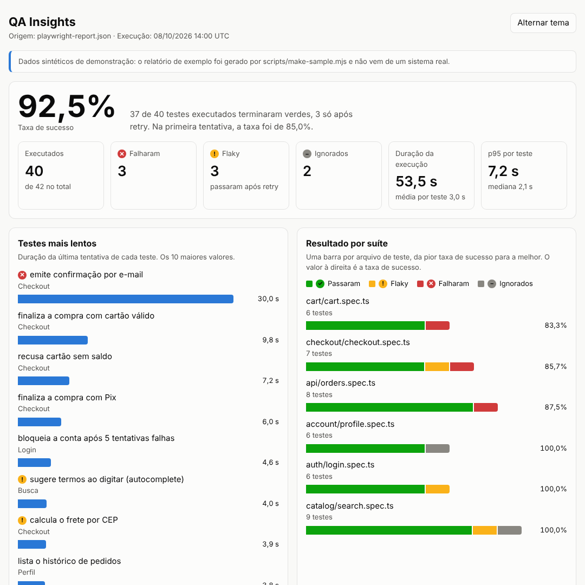

# QA Insights

Transforma o relatório JSON do Playwright em um dashboard de qualidade: taxa de sucesso, testes mais lentos, resultado por suíte e a lista de falhas e testes instáveis (*flaky*), tudo em uma única página HTML.



> **Dados de demonstração.** O relatório em `data/sample/` é **sintético**: foi gerado por [`scripts/make-sample.mjs`](scripts/make-sample.mjs) para uma loja virtual fictícia, com semente fixa (mesma saída a cada execução). Nenhum número aqui vem de um sistema real.

## Por que isso existe

O relatório padrão do Playwright mostra **uma execução**. Quem mantém uma suíte automatizada precisa responder perguntas que um relatório isolado não responde bem: quais testes estão instáveis, onde está o tempo do CI, qual suíte concentra as falhas. Este projeto começa pela base disso (a leitura e a análise de uma execução) e evolui para o histórico entre execuções (ver [Roadmap](#roadmap)).

## Status

**Fase 1: análise de uma execução.** Já faz: lê o JSON, calcula as métricas e gera o dashboard. Ainda não faz: histórico entre execuções e tendência. Isso é a Fase 2.

## Uso

Requer Node.js 20 ou superior. Não há dependências para instalar.

```bash
# 1. Gere o relatório JSON no seu projeto com Playwright
npx playwright test --reporter=json > report.json

# 2. Gere o dashboard
node src/cli.mjs report.json --out dashboard.html --title "Meu projeto"
```

Também dá para configurar o reporter no `playwright.config.ts`: `reporter: [['json', { outputFile: 'report.json' }]]`.

Para ver com os dados de exemplo:

```bash
npm run build      # regenera docs/index.html a partir de data/sample/
npm test           # roda os testes do próprio projeto
```

Opções da CLI: `--out`, `--title`, `--note` (aviso no topo da página), `--slowest <n>` (quantos testes lentos listar) e `--help`.

Para publicar no GitHub Pages: *Settings → Pages → Deploy from a branch → `main` / `/docs`*.

## Como as métricas são calculadas

| Métrica | Definição |
|---|---|
| Executados | total de testes menos os ignorados (*skipped*) |
| Taxa de sucesso | (passaram + flaky) ÷ executados. *Flaky* conta como sucesso porque terminou verde em um retry |
| Sucesso na 1ª tentativa | passaram sem precisar de retry ÷ executados. A diferença para a taxa acima mostra quanto o retry está escondendo |
| *Flaky* | teste que falhou e depois passou em um retry (o próprio Playwright classifica assim) |
| Duração de um teste | duração da **última tentativa**, que representa o teste; o custo somado de todas as tentativas fica no campo `totalMs` |
| p95 | percentil 95 pelo método do ranking mais próximo (*nearest-rank*) |

Testes ignorados ficam fora da taxa e das estatísticas de duração. Quando não há nenhum teste executado, a taxa é `null` (exibida como "–"), nunca 0% nem 100%.

## Decisões técnicas

- **Zero dependências.** Node puro (`node:test`, `node:util`, `Intl`). Nada para instalar, nada para atualizar, nada a auditar.
- **Página autocontida.** O HTML não carrega nada de fora (sem CDN, fontes ou scripts remotos): abre offline e pode ser anexado como artefato de CI. Os gráficos são HTML e CSS.
- **Dados do relatório são não confiáveis.** Títulos de teste e mensagens de erro passam por escape antes de entrar na página. Há um teste com payloads de XSS para garantir isso.
- **Saída determinística.** A mesma entrada gera exatamente o mesmo HTML (datas em UTC, sem horário de geração). Isso permite que o CI detecte se o dashboard publicado ficou desatualizado em relação ao código.
- **Acessibilidade.** Status nunca depende só de cor (ícone e rótulo em todos os lugares), há tooltip por teclado, tema claro e escuro e layout que funciona em tela de celular.
- **Erros claros na CLI.** Arquivo inexistente, JSON quebrado e JSON que não é do Playwright geram mensagens diferentes e código de saída 1.

## Qualidade do próprio projeto

Um projeto de QA precisa ser testado como qualquer outro:

- **Testes unitários e de integração** do parser, das métricas, da renderização e da CLI (`npm test`), incluindo casos de borda: relatório vazio, só testes ignorados, status ausente no JSON, mesmo teste em projetos diferentes, código ANSI em mensagens de erro.
- **Teste de regressão com números de referência** sobre o relatório de exemplo.
- **Verificação por mutação (manual).** Durante o desenvolvimento, bugs foram injetados de propósito (flaky fora da taxa, `esc` sem escapar `<`, percentil com `floor`, duração de ignorado) para confirmar que os testes falham. Um dos casos sobreviveu e gerou um teste novo.
- **CI** (GitHub Actions) em Node 20 e 22, que também falha se `docs/index.html` ou o relatório de exemplo estiverem fora de sincronia com o código.

## Estrutura

```
src/parse.mjs      lê o JSON do Playwright e normaliza os testes
src/metrics.mjs    taxa de sucesso, duração, p95, agrupamento por suíte
src/render.mjs     gera a página HTML do dashboard
src/cli.mjs        interface de linha de comando
scripts/           gerador do relatório de exemplo (sintético)
data/sample/       relatório de exemplo
docs/              dashboard gerado e imagem de preview
test/              testes do projeto
```

## Roadmap

- [x] **Fase 1:** análise de uma execução e dashboard estático
- [ ] **Fase 2:** guardar o histórico de execuções e calcular a taxa de *flakiness* por teste
- [ ] **Fase 3:** gráficos de tendência, filtros por período e deploy público automático
- [ ] **Fase 4 (opcional):** alerta (Slack/Discord) quando a instabilidade passar de um limite
